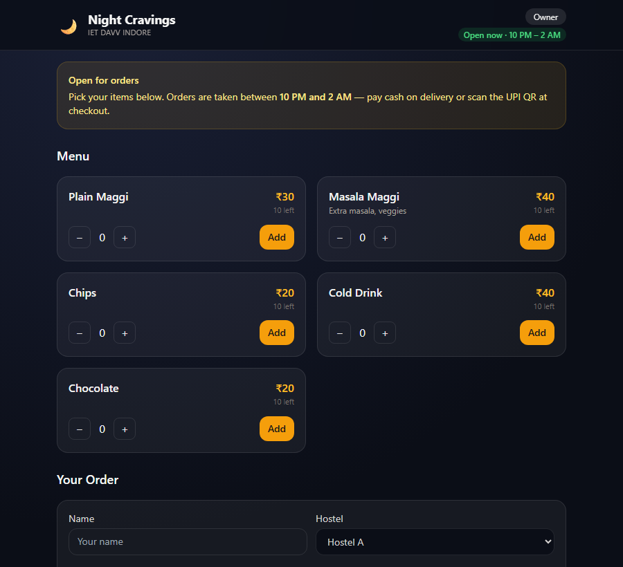

# Night Cravings

A late-night snack ordering site for my hostel. Pick items, choose cash or UPI, and the order
goes to the seller on WhatsApp. The seller manages stock and orders from a PIN-locked panel.

**[Live site](https://air01aditya.github.io/Night-Cravings/)**



Plain HTML, CSS and JavaScript. No server or database.

## Run it yourself

```bash
git clone https://github.com/air01aditya/Night-Cravings.git
cd Night-Cravings
python -m http.server 8000
```

Open `http://localhost:8000`. The WhatsApp number, PIN and menu are in `js/data.js`.

## License

[MIT](LICENSE)
